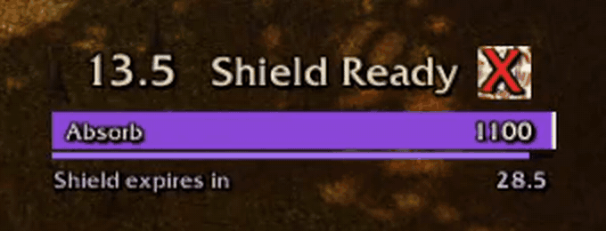
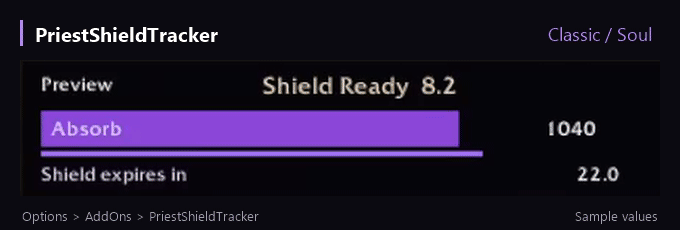

# PriestShieldTracker

**Your shield strength, shield timer, and Weakened Soul countdown in one small display.**

PriestShieldTracker helps priests in **WoW Forever** see how much protection remains, when Power Word: Shield expires, and how long until Weakened Soul ends.

*Demo mode with sample values, shown at 1.5x speed.*

## Features

- **Weakened Soul countdown:** See how long until you can shield yourself again.
- **Remaining protection:** Watch the bar and number decrease as your shields absorb damage.
- **Shield timer:** See how much time is left on Power Word: Shield, even if Weakened Soul is still counting down.
- **Make it fit your UI:** Move the bars and countdown separately, and adjust text, icon, and bar sizes.
- **Saved layouts:** Keep your settings for each character across logins and reloads.

## Make It Your Own

*Move and resize your display in Edit Mode, with separate text and icon controls.*

Open **Esc > Edit Mode** or type `/pst`. Click either group to change its settings, drag it where you want it, then click **Save**.

## Customization

Choose **Classic**, **Smooth**, or **Liquid** bars and six color palettes in **Options > AddOns > PriestShieldTracker**. Bar and text colors can also be adjusted separately. Keep sizing and positioning in Edit Mode.

**Left-click** the minimap shield for settings. **Right-click** to open or close Edit Mode.

*Edited preview with sample values. Shows selected styles and palettes at normal speed, with menu interactions removed.*

## Usage

Cast **Power Word: Shield** on yourself to see the display. Shield yourself outside combat first so the bar learns what a full shield looks like. The display hides when there is nothing to track.

- `/pst` - Open Edit Mode.
- `/pst test` - Preview the animated bars. Run it again to stop.
- `/pst reset` - Restore the default layout.

## Installation

Version **0.3.1** supports **WoW Forever 1.60.1**.

1. Download the PriestShieldTracker ZIP from [GitHub Releases](https://github.com/Baeleaf/PriestShieldTracker/releases).
2. Extract both included folders into `World of Warcraft/_forever_/Interface/AddOns/`. The small settings importer preserves your previous layout.
3. Restart WoW and enable PriestShieldTracker on your priest.

## Good to Know

PriestShieldTracker tracks your own character. The protection number includes all active shields. **Shield Ready** follows Weakened Soul; you still need enough mana to cast. See the [tracking notes](docs/REFERENCE.md#forever-restrictions) for limitations when another priest shields you.

## Feedback

Found a bug or have an idea? [Open a GitHub issue](https://github.com/Baeleaf/PriestShieldTracker/issues).

## More

[Detailed guide & troubleshooting](docs/REFERENCE.md) | [All Rights Reserved](LICENSE)
