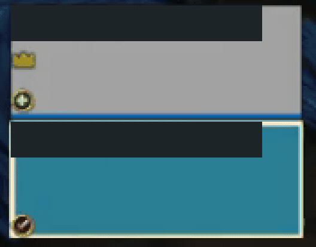
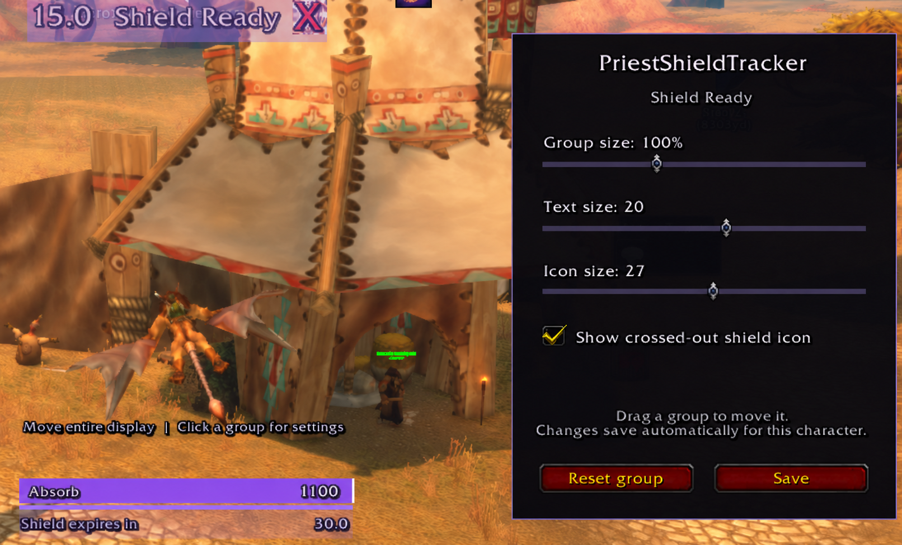

# PriestShieldTracker

**Your shield strength, shield timer, and Weakened Soul countdown in one small display.**

PriestShieldTracker helps priests in **WoW Forever** see how much protection remains, when Power Word: Shield expires, and how long until Weakened Soul ends.

*Demo mode with sample values, shown at 1.5x speed.*

## Features

- **Weakened Soul countdown:** See how long until you can shield yourself again.
- **Remaining protection:** Watch the bar and number decrease as your shields absorb damage.
- **Shield timer:** See how much time is left on Power Word: Shield, even if Weakened Soul is still counting down.
- **Make it fit your UI:** Move the bars and countdown separately, and adjust text, icon, and bar sizes.
- **Saved layouts:** Keep your settings for each character across logins and reloads.
- **Shadow Word: Death execute glow:** Your highest learned rank glows on matching action buttons and cooldown manager icons when the target is below its minimum damage estimate and the spell is ready. The glow stays visible through the GCD.
- **Automatic language support:** Uses your game language, with English fallback.
- **Party and raid indicators:** Small Weakened Soul icons on Blizzard's group frames show a cooldown swipe and countdown. WeakenedSoulTracker is not required.

## Live Party-Frame Tracking

*Recorded in WoW Forever at normal speed. Cropped to the party frames; character names covered and cursor excluded.*

## Make It Your Own

*Move and resize your display in Edit Mode, with separate text and icon controls.*

Open **Esc > Edit Mode** or type `/pst`. Click either group to change its settings, drag it where you want it, then click **Save**.

## Customization

Choose **Classic**, **Smooth**, or **Liquid** bars and six color palettes, plus **Random**, in **Options > AddOns > PriestShieldTracker**. Bar and text colors can also be adjusted separately. Keep sizing and positioning in Edit Mode.

**Random** chooses a different palette on login/reload and every 15–30 minutes, waiting until combat and editing finish.

**Left-click** the minimap shield to open or close settings. **Right-click** to open or close Edit Mode.

*Edited preview with sample values. Shows selected styles and palettes at normal speed, with menu interactions removed.*

## Feature Switches

In **Options > AddOns > PriestShieldTracker** (`/pst settings`), turn Weakened Soul icons on party and raid frames on or off and preview their appearance on sample frames.

In **Edit Mode**, click **Shield Ready** or **Absorb display** and use **Enabled** to turn that group on or off. The Shield Ready window also contains **Show crossed-out shield icon**. Disabled groups remain selectable in Edit Mode so you can turn them back on.

The **Shadow Word: Death > Enabled** checkbox in AddOns settings controls its icon glow. The estimate ignores resistances, absorbs, and damage reduction.

Features are enabled by default and saved for each character. Change these settings outside combat.

## Usage

Cast **Power Word: Shield** on yourself to see the display. Shield yourself outside combat first so the bar learns what a full shield looks like. The display hides when there is nothing to track.

- `/pst` - Open Edit Mode.
- `/pst test` - Preview the animated bars. Run it again to stop.
- `/pst reset` - Restore the default layout.
- `/pst glowtest` - Preview matching SWD icon glows for five seconds outside combat.
- `/pst execute` - Show the detected SWD rank, damage estimate, and matching icon counts.

## Installation

Version **0.3.4** supports **WoW Forever 1.60.1**.

1. Download the PriestShieldTracker ZIP from [GitHub Releases](https://github.com/Baeleaf/PriestShieldTracker/releases).
2. Extract both included folders into `World of Warcraft/_forever_/Interface/AddOns/`. The small settings importer preserves your previous layout.
3. Restart WoW and enable PriestShieldTracker on your priest.

## Good to Know

The main display tracks your own character; the small indicators track players on Blizzard's party and raid frames. The protection number includes all active shields. **Shield Ready** follows Weakened Soul; you still need enough mana to cast. See the [tracking notes](docs/REFERENCE.md#forever-restrictions) for limitations when another priest shields you.

## Feedback

Found a bug or have an idea? [Open a GitHub issue](https://github.com/Baeleaf/PriestShieldTracker/issues).

## More

[Detailed guide & troubleshooting](docs/REFERENCE.md) | [All Rights Reserved](LICENSE)
