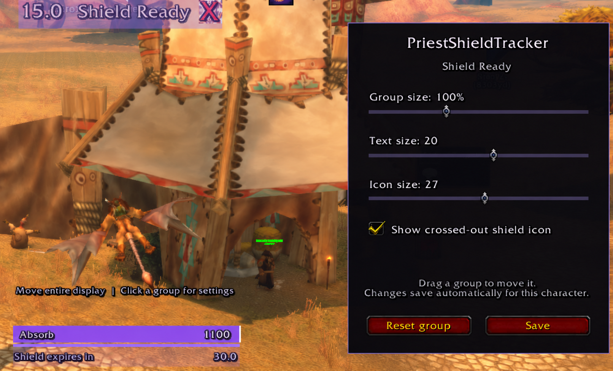

# PriestShieldTracker detailed reference

For the short player guide, see [README](../README.md). This page contains detailed behavior, troubleshooting notes, development information, and testing steps.

## Compatibility

| WoW client | Support |
| --- | --- |
| WoW Forever 1.60.1 | Supported target; interface `16001`, game type `camelot`. Tested interactively during development. |
| Retail | Not supported or advertised. |
| Classic Era, Hardcore, Anniversary, or progression Classic | Not supported or advertised. |

This matches [WeakenedSoulTracker's published version coverage](https://www.curseforge.com/wow/addons/weakenedsoultracker/files/all), which lists Forever 1.60.1. PriestShieldTracker is a separate addon and does not require WeakenedSoulTracker. Additional client support would need a separate compatibility implementation and in-game validation, not just a different interface number.

## Install

Extract the **PriestShieldTracker** folder into your WoW `_forever_/Interface/AddOns` folder. Restart the client if the addon is new, then enable PriestShieldTracker on your priest. Earlier builds have been tested in game; each new update still needs an in-game check.

The manifest restricts loading to Forever. Install only this repository's PriestShieldTracker folder; WeakenedSoulTracker is optional and is not modified by PriestShieldTracker.

## Use

Open **Esc → Edit Mode** to show PriestShieldTracker's two draggable groups. Click the element you want to edit to open its settings. Click the other element to switch options in the same menu. Drag a group to move it, or drag **Move entire display** to move both groups together.

The menu starts hidden and follows the selected group. Clicking outside both the element groups and the menu clears the selection and hides the menu, while leaving Edit Mode open. Clicking or dragging controls inside the menu keeps it open. The selected group is highlighted until you click elsewhere.

Drag the **PriestShieldTracker** title bar to move the settings panel. It stays within the screen and remembers its position across reloads. Moving the menu does not move either display group.

Both groups have independent **Enabled**, **Group size**, and **Text size** controls in their Edit Mode windows. The Shield Ready group also has **Icon size** and **Show crossed-out shield icon**. The absorb group has **Bar width** and **Bar height** controls. Turning **Enabled** off hides that group during play, while its labeled selection area remains available in Edit Mode so you can turn it back on. **Reset group** enables the selected group and restores its default sizes and position while keeping the icon visibility choice. **Save** finishes editing and closes Edit Mode.

Left-click the minimap shield to open settings; left-click again to close them. Right-click toggles Edit Mode.



*Move and resize your display in Edit Mode, with separate text and icon controls.*

PriestShieldTracker settings save automatically per character as they change. They currently apply across Blizzard layout presets; Blizzard's Save/Discard actions do not revert these separate addon settings. Editing closes on combat entry, and does not automatically reopen afterward when entered through Blizzard Edit Mode.

`/pst` or `/priestshieldtracker` opens the same Edit Mode workflow. If Blizzard Edit Mode is unavailable, it opens PriestShieldTracker's standalone editor.

| Command | Effect |
| --- | --- |
| `/pst test` | Toggle a looping demonstration; automatically ends on entering combat. |
| `/pst edit` | Open Edit Mode and PriestShieldTracker's settings. |
| `/pst calibrate` | Treat current absorbs as full; use immediately after a fresh shield outside combat. |
| `/pst reset` | Restore the default position, size, and lock. |
| `/pst status` | Show whether native timer setup succeeded. |

Position, group offsets, group appearance, and the last readable absorb reference are saved separately for each character. The Shield Ready label, countdown, and icon always move together. The absorb bar, label, number, duration strip, and shield-expiration text move together as the shield group. Existing individual layouts are regrouped around the old label and absorb-bar positions, restoring consistent spacing inside each group. The old `/pst unlock`, `/pst lock`, `/pst width`, and `/pst scale` commands remain compatibility aliases; they are no longer needed to edit the display.

Every login or reload starts locked; editing previews are never restored from a previous session. `/pst reset` also restores both groups' appearance and positions. Samples use separate widgets from the live display, so preview values cannot remain on the live bar when editing ends.

## What the display means

**Absorb** is the client's total remaining absorption, including other shields if present. It does not report damage already absorbed, nor isolate Power Word: Shield. The absorb bar disappears when total absorption reaches zero. The lower timer specifically follows Power Word: Shield and disappears when that aura breaks, expires, or is removed. Weakened Soul's countdown remains independent, so it can continue after your shield breaks. With no absorption or tracked auras, the display is hidden unless you are editing or previewing it.

The white edge marks remaining absorption, not a prediction of the next hit. The thin lower strip tracks time separately from shield strength.

Shield Ready's countdown is the remaining Weakened Soul duration, not a separate spell cooldown. The default compact row is 188 pixels wide, arranged countdown, right-aligned label, then the crossed-out Power Word: Shield icon to the right of the words. Its spacing expands with text and icon sizes, and collapses when the icon is hidden. All three move together. The row, including the icon and red X, disappears when that debuff ends.

Both countdowns use Blizzard's duration text bindings with a numeric formatter that rounds to the nearest 0.1 second and refreshes every 0.05 seconds. Whole seconds retain the decimal, such as `5.0`. Preview countdowns use the same one-decimal presentation.

Absorption refreshes immediately on player absorb, aura, health, and maximum-health events, and independently every 0.1 seconds. This catches missed events and unit values that settle after the initial event. The numeric amount is passed directly from `UnitGetTotalAbsorbs("player")`; it is not estimated by subtracting damage.

The bar learns its full reference from readable absorb increases, normally when shielding before combat. It retains that reference through damage. If the first observation happens during combat with no learned reference, the bar temporarily uses maximum health as its scale; the numeric absorb remains the game's reported value. Cast a fresh shield outside combat to learn a full reference. No shield formula or made-up fixed 15/30-second live timers are used.

## Forever restrictions

Layout and color changes check each native region's current access, rather than relying only on combat lockdown. In dungeons, aura objects can remain locked between pulls. Changes to locked regions wait until the game allows access again; Blizzard continues drawing the live timers. Pending changes retry once per second outside combat and on world transitions.

## Party and raid indicators

PriestShieldTracker includes the icon renderer and frame discovery from Weakened Soul Tracker 2.6.0 by nocktambule (MIT; see `licenses/WeakenedSoulTracker.txt`), adapted for access checks and deferred configuration. No files, saved variables, or running code from that addon are required. Disable WeakenedSoulTracker before testing to avoid duplicate indicators, then restart WoW once to load the new files.

The default is a 16-pixel icon in the top-right corner of Blizzard party and raid frames, with the game-drawn icon, cooldown swipe, remaining seconds, and a red border for your applications. The countdown turns green in the last three seconds. Icons do not intercept targeting or click-casting. Classic party frames, compact party frames, and both grouped and ungrouped compact raid frames are supported. Nameplates, pets, target frames, and third-party unit-frame addons are excluded.

The **Party and raid frames** section in AddOns options controls visibility, corner, size, countdown format, and green countdown threshold. Other priests' applications retain the upstream purple border. With exact spell filtering available, all priests are shown. Otherwise only your own applications are shown by default; **Include other priests** enables property matching for theirs, which can also match some monster debuffs. The personal HUD's existing self-shield filter is unchanged.

Hover over settings and Edit Mode controls for explanations. AddOns options includes sample party/raid frames with animated Weakened Soul icons and timers. The samples follow the icon visibility, other-priest option, corner, size, countdown format, and green threshold immediately; the other-priest sample icon is hidden while that option is off. These are fictional players and timers, independent of real group activity.

## Aura and absorb data

Native AuraContainer slots draw the actual aura timers without Lua inspecting restricted combat aura values. Helpful shield filtering includes the ten Classic Power Word: Shield ranks. Harmful aura identity filters are restricted on friendly units unless the spell is marked NeverSecret. When necessary, the Weakened Soul slot instead selects your own short, non-dispellable, non-boss debuff. This targets solo self-shielding; another priest's Weakened Soul may not be shown under that fallback, and another debuff with identical properties may appear. The custom label reads Shield Ready; the game supplies the countdown.

The absorb StatusBar and FontStrings belong to an ordinary addon-owned frame outside the protected aura subtree. Combat absorb numbers are passed directly to those native widget methods. A transparent 0..1 StatusBar clips the absorb display to its native fill, rendering nothing at zero and the full display for positive whole-point absorption. The addon does not query the fill's size, shown state, or value. No curve evaluation receives a secret number: that API permits secrets only in untainted execution, while StatusBar:SetValue explicitly permits them in addon execution. Restricted values are never compared, formatted in Lua, or saved. The addon does not read the combat log or infer private aura state from UI widgets. The aura buttons remain responsible for drawing their own timers; the absorb refresher never writes to them.

## In-game acceptance check

1. Open Esc → Edit Mode. Confirm the icon is to the right of Shield Ready and no settings menu opens until you click an element. Click each group and try group size, text size, icon options, and absorb bar dimensions. Drag both groups, then use Save. With no active auras, closing Edit Mode should leave the screen empty. Try `/pst test` separately and toggle it off.
2. Cast Power Word: Shield on yourself outside combat. Check that the bar fills and both timers appear.
3. Take hits. Verify that absorption and the white edge decrease; the duration strip should continue with time. Check both countdowns show tenths and that repeated damage does not generate forbidden-object errors, including after a reload without an absorb reference.
4. Let the shield break while Weakened Soul remains. The absorb bar should disappear immediately and the debuff countdown should continue independently. With neither aura active, nothing should remain visible; also try this out of combat.
5. Shield again in combat, then try expiration, dispel/removal, death, zoning, and `/reload` with an active shield. Watch BugSack for errors.
6. Cast on another player; confirm their shield does not reset your current absorb reference. Try a lower/higher rank and overlapping absorbs.
7. Confirm positions and appearance persist after reload, including dragging after changing group size. Reload while editing: the saved layout should return locked with no sample. Enter combat while editing; the sample and settings should close, live timers should return, and editing should stay closed afterward. Test Reset group without changing the other group.

## Development

The repository root is the addon folder. For local development, clone it into `_forever_/Interface/AddOns/PriestShieldTracker`.

Run the Lua 5.1 boundary-model checks with Python and the development dependency:

```sh
python -m pip install -r requirements-dev.txt
python tests/check.py
```

The current suite contains 34 logic checks. It models forbidden aura widgets and rejects secret curve evaluation from addon code. Passing it does not replace in-game combat, rendering, or Edit Mode verification. Keep those checks in the acceptance list above when changing the UI or client integration.

## API references

Implementation follows Blizzard's Forever UI interfaces:

- https://github.com/Gethe/wow-ui-source/blob/forever/Interface/AddOns/Blizzard_AuraContainer/Blizzard_CustomAuraContainer.lua
- https://github.com/Gethe/wow-ui-source/blob/forever/Interface/AddOns/Blizzard_AuraContainer/Blizzard_CustomAuraButton.lua
- https://github.com/Gethe/wow-ui-source/blob/forever/Interface/AddOns/Blizzard_AuraContainer/Blizzard_AuraContainerUtil.lua

No code or artwork from the reference addons is bundled.

## License

Copyright (c) 2026 Baeleaf. **All Rights Reserved.** Personal installation and use are permitted. See [LICENSE](../LICENSE) for the full notice.
